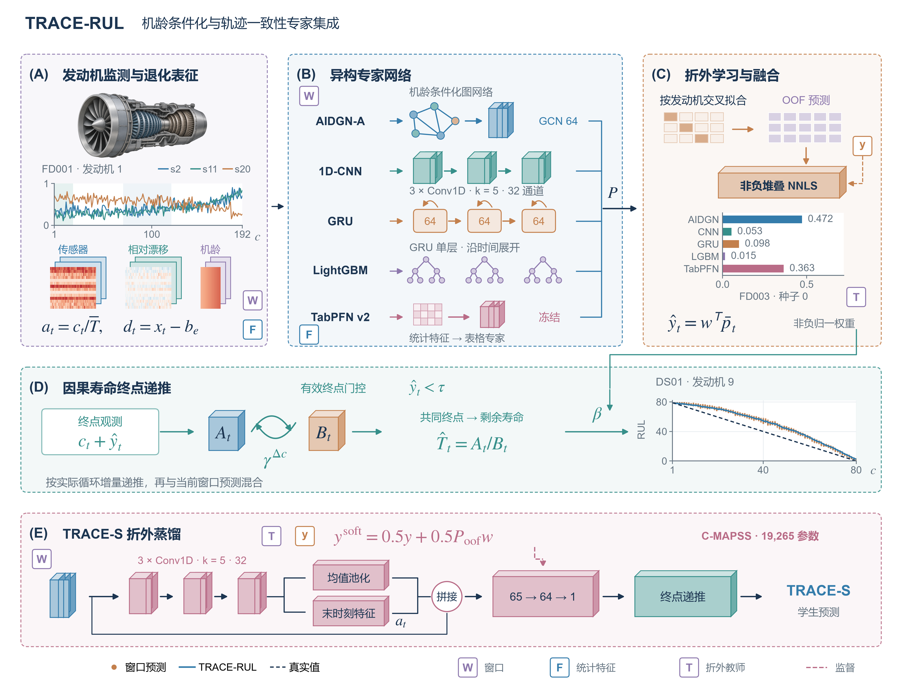

# TRACE-RUL

## 论文题目

**TRACE-RUL：面向航空发动机剩余寿命预测的机龄条件化与轨迹一致性专家集成**

English title: **TRACE-RUL: Age-Conditioned and Trajectory-Consistent Expert Ensembling for Aero-Engine Remaining Useful Life Prediction**

本仓库整理了论文对应的实验实现、运行入口和原有实验结果摘要。TRACE-RUL 将运行机龄、传感器退化表征、异构专家预测和连续观测中的寿命终点约束结合起来。TRACE-S 使用折外教师预测与真实标签训练紧凑卷积网络。



图中的曲线、输入矩阵和融合权重来自已有实验数据，发动机插图为生成式示意素材。该图用于方法说明。

## 方法与代码

| 模块 | 实现 | 作用 |
| --- | --- | --- |
| C-MAPSS 预处理 | `code/cmapss.py`, `code/trace_data.py` | 工况归一化、机龄、相对早期状态的漂移、滑动窗口及表格特征 |
| N-CMAPSS 预处理 | `code/ncmapss.py` | 单元划分、采样、归一化和窗口构造 |
| 异构专家 | `code/experts.py`, `code/aidgn.py` | AIDGN-A、1D-CNN、GRU、LightGBM 及可选 TabPFN v2 |
| 发动机级交叉拟合 | `code/run_trace_cmapss.py`, `code/run_trace_ncmapss.py` | 生成折外训练预测和各折平均测试预测 |
| 专家融合和轨迹约束 | `code/trace_post.py` | 非负最小二乘堆叠、寿命终点递推及当前预测混合 |
| 评估 | `code/eval_cmapss.py`, `code/eval_ncmapss.py` | RMSE、Score、融合权重及轨迹参数 |
| TRACE-S | `code/distill.py` | 真实标签与折外教师信号共同监督的学生训练 |
| 对照实验 | `code/train_aidgn.py`, `code/train_aidgn_n.py`, `code/age_only.py`, `code/noise_aidgn.py` | 对照模型、仅机龄预测及噪声评估 |
| 效率与可视化 | `code/efficiency.py`, `code/collect.py`, `code/make_figs.py` | 参数量、推理延迟、结果汇总和实验图 |

### 两个基准的实际配置

| 配置 | C-MAPSS | N-CMAPSS |
| --- | --- | --- |
| 主实验子集 | FD001–FD004 | DS01–DS07 |
| 已有主实验随机种子 | 0–2 | 0–2 |
| 输入通道 | 14 个传感器 + 14 个漂移 + 1 个机龄 | 20 个观测通道 + 1 个机龄 |
| 窗口长度 | 50 | 50 个采样点 |
| 主实验专家 | AIDGN-A、CNN、GRU、LightGBM、TabPFN v2 | AIDGN-A、CNN、GRU、LightGBM |
| 交叉拟合 | 发动机级 5 折 | 开发单元逐个留出（`--louo`） |
| 评估位置 | 每台测试发动机的最后一个窗口 | 测试单元的全部窗口 |
| Score 汇总 | 求和 | 求均值 |
| TRACE-S 参数量 | **19,265** | **17,985** |

19,265 对应 29 通道的 C-MAPSS 学生网络。N-CMAPSS 的 21 通道版本采用相同网络结构，但第一层输入通道数不同。已有 FD003 百台发动机批量推理记录中的 GPU 延迟为约 0.49 ms；该记录对应 C-MAPSS 配置，计时结果受硬件和运行环境影响。原始数值保存在 [`reference_results/efficiency.json`](reference_results/efficiency.json)。

## 安装

使用独立 Python 环境，先安装适配本机 CUDA 或 CPU 的 PyTorch，再安装核心依赖：

```bash
python -m venv .venv
# Linux / macOS
source .venv/bin/activate
# Windows 可运行 .venv\Scripts\activate
python -m pip install torch
python -m pip install -r requirements.txt
```

完整 C-MAPSS 五专家配置另需 TabPFN v2 兼容软件包和对应模型权重：

```bash
python -m pip install -r requirements-tabpfn.txt
```

依赖清单根据源代码导入项整理，并非原训练环境的版本锁定文件。TabPFN 使用本地 v2 权重；安装较新 API 时请核对兼容性。原始 TabPFN 调用固定使用 CUDA。无 GPU 时可先运行四专家配置，结果不应标记为论文的五专家主结果。

## 数据准备

数据集与权重不随代码上传。将获得的数据放到以下默认位置，或设置环境变量：

```text
repo/AIDGN-RUL/CMAPSS/
  train_FD001.txt  test_FD001.txt  RUL_FD001.txt
  ... FD002 / FD003 / FD004
data/ncmapss/h5/
  N-CMAPSS_DS01*.h5
  ... DS02 / DS03 / DS04 / DS05 / DS06 / DS07
```

| 环境变量 | 指向 |
| --- | --- |
| `TRACE_CMAPSS_DIR` | 包含 `train_FD001.txt` 等文件的目录 |
| `TRACE_NCMAPSS_DIR` | N-CMAPSS HDF5 文件所在目录，可含子目录 |
| `TRACE_TABPFN_CKPT` | `tabpfn-v2-regressor.ckpt` 文件 |

TabPFN 默认权重位置为 `~/.cache/tabpfn/tabpfn-v2-regressor.ckpt`。N-CMAPSS 预处理缓存写入 `data/ncmapss/cache`。更换数据或预处理规则时，应使用相应的新缓存。

## 运行主实验

在仓库根目录运行。训练时间取决于数据集、设备与专家配置。

### C-MAPSS：单个子集、单个种子

```bash
python code/run_trace_cmapss.py FD001 0 --experts aidgna,cnn,gru,lgbm,tabpfn --tag trace
python code/eval_cmapss.py trace FD001 0
python code/distill.py cmapss FD001 0 --tag trace
```

完整四子集、三个种子实验可使用统一入口。该入口依次执行训练、评估与学生训练，并提供只显示命令的模式：

```bash
python tools/run_experiments.py cmapss --dry-run
python tools/run_experiments.py cmapss
```

### N-CMAPSS：单个子集、单个种子

```bash
python code/run_trace_ncmapss.py DS01 0 --experts aidgna,cnn,gru,lgbm --tag trace_louo --louo
python code/eval_ncmapss.py trace_louo DS01 0
python code/distill.py ncmapss DS01 0 --tag trace_louo
```

完整七子集、三个种子实验：

```bash
python tools/run_experiments.py ncmapss --dry-run
python tools/run_experiments.py ncmapss
```

默认保留已有训练和学生结果，评估会根据预测文件重新计算。需要重新训练时，为统一入口指定一个新 `--tag`。神经网络专家训练脚本保存折外预测和测试预测，不导出每一折专家的模型权重；学生模型另存为 `_student.pt`。

5 折表示每次实验按发动机分成 5 组进行交叉拟合，随机种子表示重复整次实验，二者不同。原始 `q_*.sh` 保留了曾安排更多种子的队列；本仓库实际已有的两个基准主结果均为种子 0、1、2，统一入口据此设置默认值。

### 组件与对照实验

```bash
# C-MAPSS：使用相同四专家集合比较完整输入、去机龄和去漂移
python code/run_trace_cmapss.py FD001 0 --experts aidgna,cnn,gru,lgbm --tag trace4
python code/run_trace_cmapss.py FD001 0 --experts aidgna,cnn,gru,lgbm --tag trace_noage --no_age
python code/run_trace_cmapss.py FD001 0 --experts aidgna,cnn,gru,lgbm --tag trace_nodrift --no_drift
python code/eval_cmapss.py trace4 FD001 0
python code/eval_cmapss.py trace_noage FD001 0
python code/eval_cmapss.py trace_nodrift FD001 0

# AIDGN 对照训练
python code/train_aidgn.py FD001 0
python code/train_aidgn_n.py DS01 0
```

`eval_*.py` 同时生成单专家、均匀平均及 NNLS 堆叠的 raw / TT 结果。N-CMAPSS 去机龄实验使用四专家、`--louo --no_age` 和独立 tag。不要将不同专家集合混为同一组受控消融。`distill.py` 面向主实验输入配置，不用于去机龄或去漂移的学生消融。

## 已有结果与验证范围

[`reference_results/`](reference_results/) 保存源工程已有的 JSON 指标，包括各子集、种子、配置及汇总记录。训练输出写入另外的 `results/` 目录，以便区分既有记录与新运行结果。结果包含主实验和探索配置，文件夹名需要与运行参数一起解释。

```bash
python tools/summarize_results.py
python tools/check_release.py
```

整理时完成源文件语法检查、结果 JSON 读取检查、训练命令生成检查和轨迹递推数值检查；本次上传未重新训练全部模型。`code/make_tables.py`、`make_prose.py` 和 `make_report.py` 为早期实验报告生成工具，保留供追溯，不代表当前论文的最终文字或表格版本。

## 来源与许可

AIDGN 架构及部分基准预处理参考 [TCCofWANG/AIDGN-RUL](https://github.com/TCCofWANG/AIDGN-RUL)，源版本为 `d1ac173b13659af1854cf500a9b1cba8367353fe`。`code/aidgn_official` 保留原项目中已有的对照代码；原来源说明与版权归属保持不变。该源快照未包含根目录 LICENSE，本次整理不为第三方代码添加新的授权声明。详见 [THIRD_PARTY_NOTICES.md](THIRD_PARTY_NOTICES.md)。

源文件校验清单见 [`docs/source_manifest.json`](docs/source_manifest.json)。整理只增加路径环境变量和便携运行入口，未修改原实验的训练、融合或评价算法。
